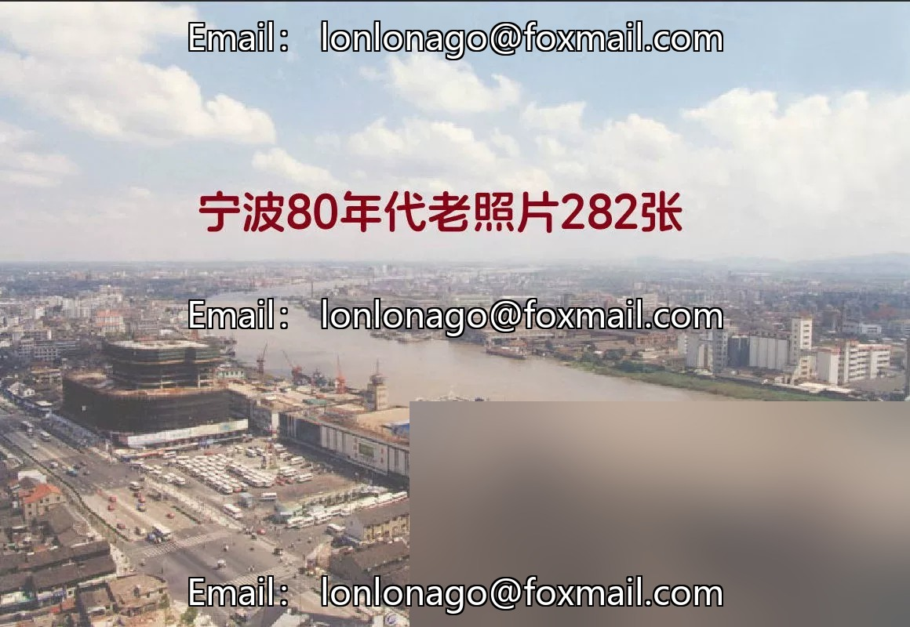
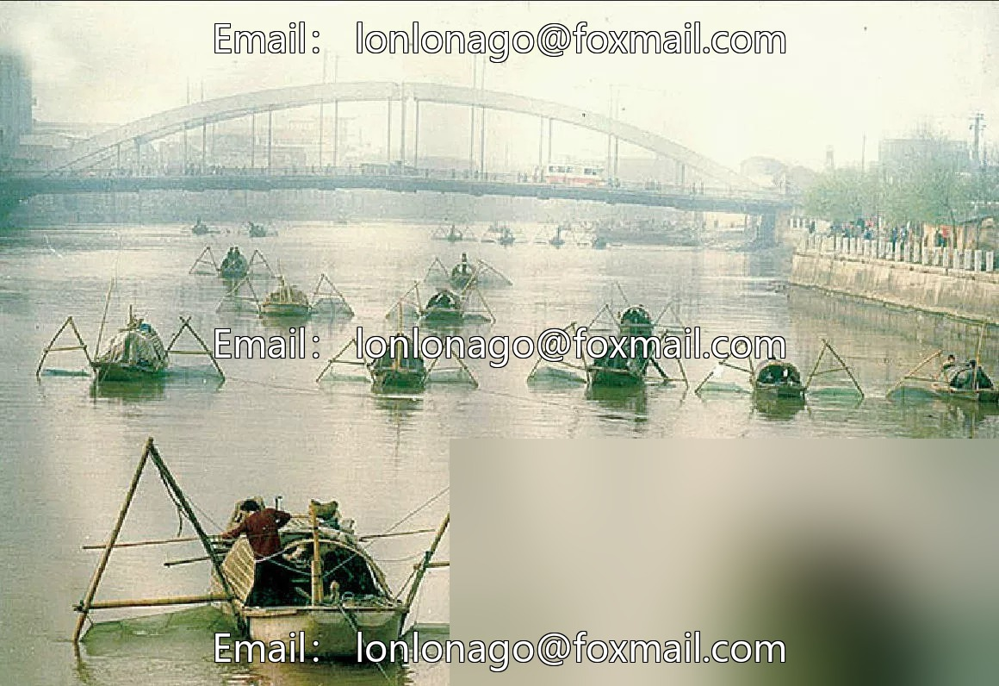
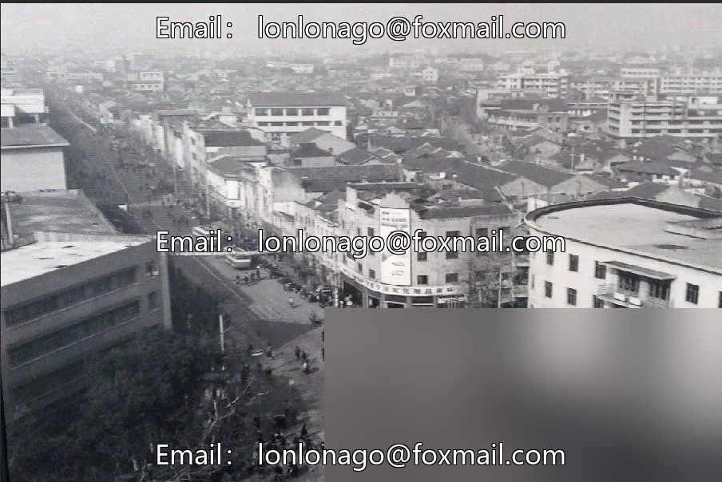
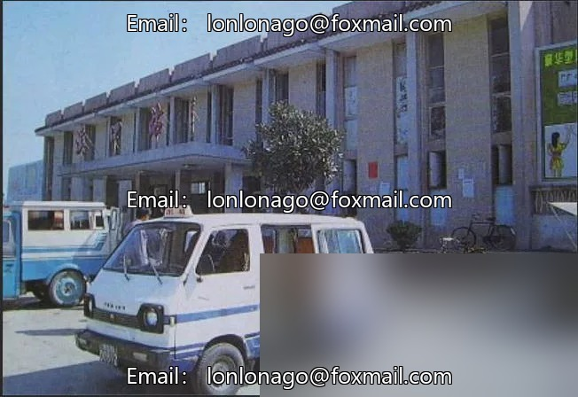
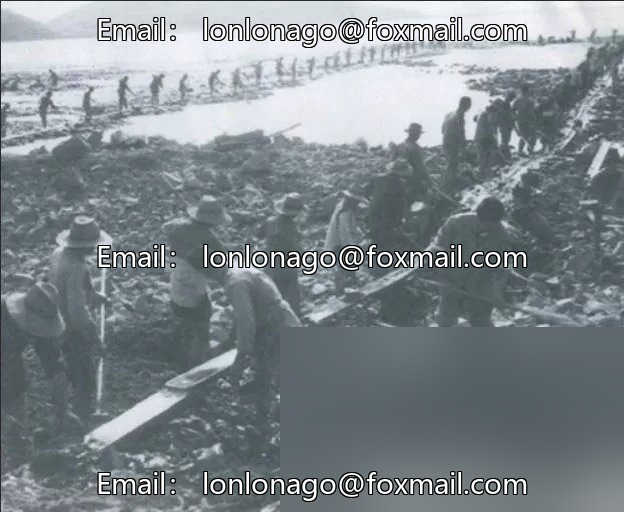
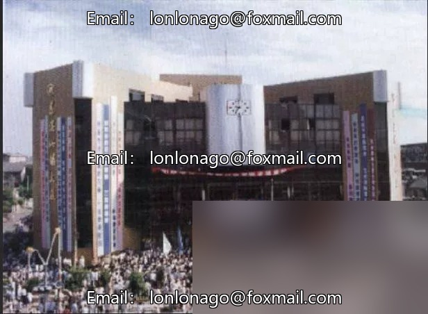
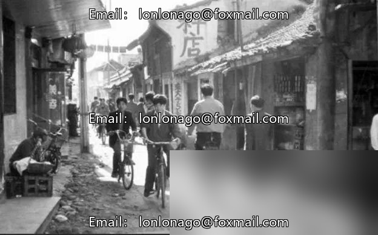
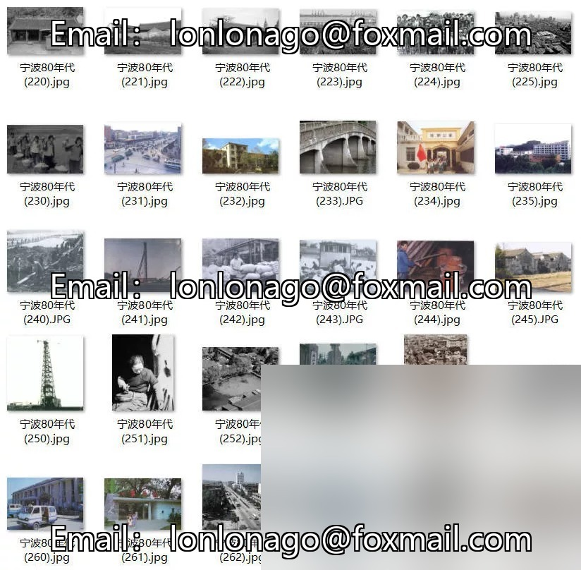
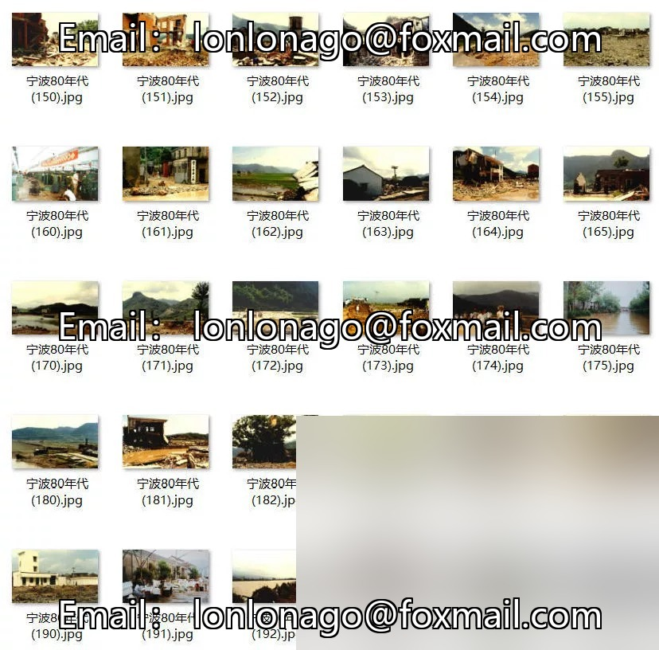

# 80s Ningbo old photo image , nostalgic of precious historical moments, containing figures, agricultural scenes

## Body

80s Ningbo old photos collection, nostalgic collection of precious historical moments, featuring scenes such as people, rural areas, urban areas, and daily life, with a total of 282 Ningbo city black and white and colored old photos.

Because the camera quality at that time was generally poor, the effect of the photos was also not very good, and the clarity was generally average. Please note!

cloud disk sharing, take a screenshot directly

The collection features 80s Ningbo old photos totaling 282 images across people, rural, urban and daily scenes, including Qinghua type, Runan bath, Qingyu sea day and other images; it also notes average poor clarity and general sharpness.

<!-- AI_ENRICHED -->

## Images

## Payment

Here is a pay link on Stripe ( https://buy.stripe.com/3cs8yP7sY87d0vu9AB ). Please contact me lonlonago@foxmail.com after funding $89, and I will send you a complete data files , thank you!

